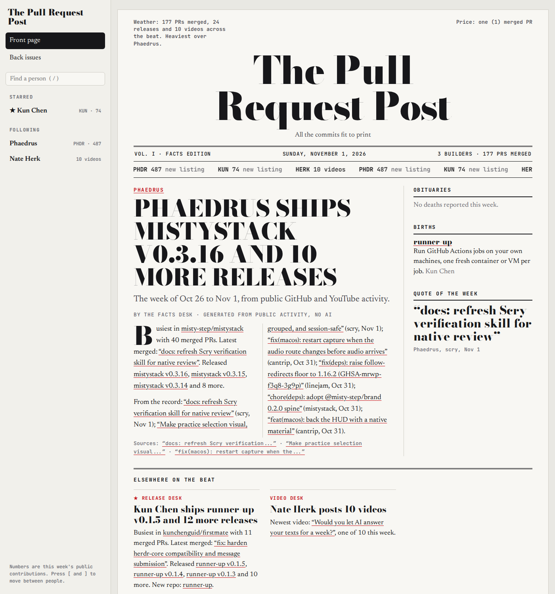
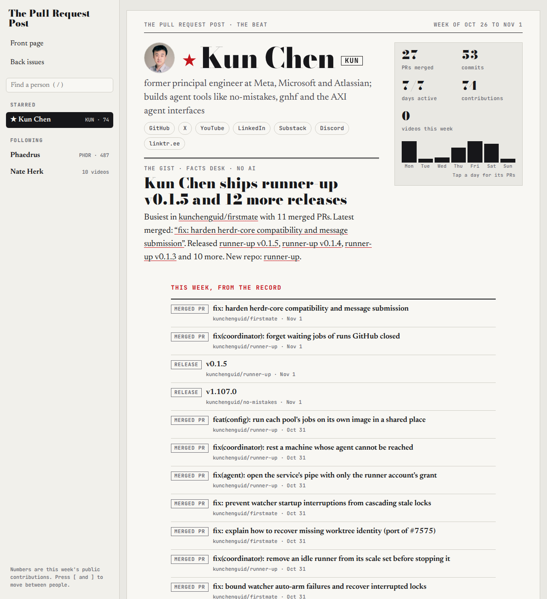
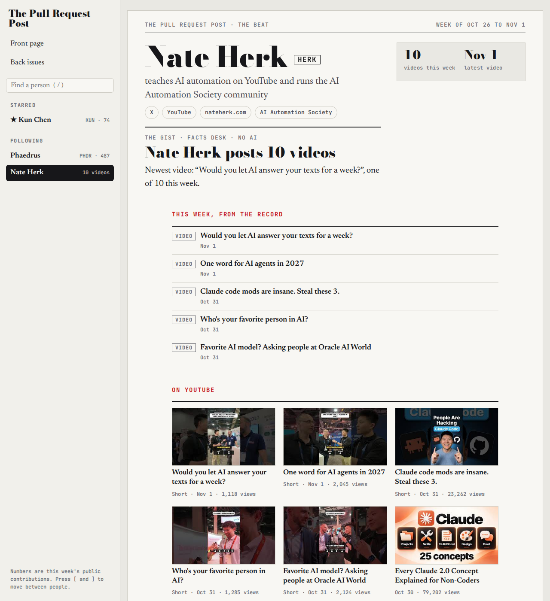
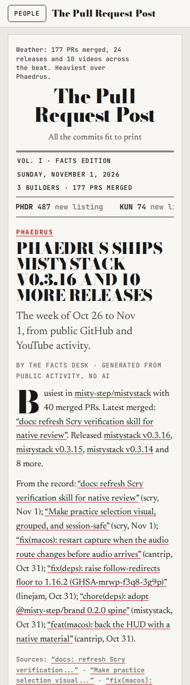

# pr-post

Follow what your favorite builders ship.
pr-post turns the public GitHub and YouTube activity of the people you choose into a small newspaper, **The Pull Request Post**, plus a `feed.json` you can embed on your own site.

**Live demo:** https://n8watkins.github.io/pr-post/ (following Kun Chen, Phaedrus and Nate Herk)
**Demo feed:** https://n8watkins.github.io/pr-post/feed.json



| A builder's page | A YouTube-only person | On a phone |
| --- | --- | --- |
|  |  |  |

## What it does

- **Collects public facts** twice a week: merged pull requests, commits, releases, new and archived repositories and the contribution graph from GitHub, and recent videos from a channel's YouTube RSS feed (no API key).
  If a YouTube feed fails, the videos from the previous run are kept, so a flaky feed never blanks a page.
- **Prints a newspaper** from those facts alone: a front page with a lead story, box scores and a commit ticker, and a page per person with their week, recent work, videos and the repositories where the time went.
  No AI is needed.
- **Publishes `feed.json`**, a documented and versioned feed of who you follow and what they shipped, for your own site.
- **Leaves room for writers.** A Claude Code routine, or later a Gemini key in Actions, can add written reports and summaries on top; anything an AI writes is labelled.

It is plain Python 3.11+ standard library and a little vanilla JavaScript.
There is nothing to install.

## Quickstart: your own paper on GitHub Pages

1. **Fork** this repository.
2. **Edit `demo/watchlist.toml`**: change `[site] title` if you like and replace the `[[people]]` with the people you want to follow.
   Or keep the demo as is and put your paper in its own folder (say `paper/watchlist.toml`), then add a repository variable `PR_POST_PAPER` set to `paper` under **Settings**, **Secrets and variables**, **Actions**, **Variables**.
3. **Enable Pages**: **Settings**, **Pages**, **Build and deployment**, **Source: GitHub Actions**.
4. **Run it**: **Actions**, **Demo site**, **Run workflow**.
   After that it runs every Wednesday and Saturday.

Your paper appears at `https://<you>.github.io/<repo>/` and its feed at `https://<you>.github.io/<repo>/feed.json`.
Forks do not run scheduled workflows until you enable Actions on the fork.

### Run it locally

```sh
export GITHUB_TOKEN=$(gh auth token)              # optional; without it you get 60 requests an hour and no contribution graph
python3 scripts/collect.py --paper demo           # -> demo/data/
python3 scripts/stats.py --paper demo             # -> demo/stats/
python3 scripts/build_site.py --paper demo        # -> dist/ (pages and feed.json)
python3 scripts/feed.py --check dist/feed.json    # validate the feed
python3 -m http.server -d dist 8737               # open http://localhost:8737
```

## Configuration

Everything lives in one `watchlist.toml`, and every setting has a default.
The folder that holds it is the **paper**; collected data, stats and any written material live beside it.

```toml
[site]
title = "The Pull Request Post"     # masthead and page titles
motto = "All the commits fit to print"
mode = "public"                     # "public" (GitHub Pages) or "private" (Cloudflare Worker with sign-in)
show_private_counts = false         # private mode only: print GitHub's private contribution counts
desk = "the facts desk"             # byline on pages built from facts
url = ""                            # public address; the Pages workflow fills it in
base_path = ""                      # e.g. "/pr-post"; the Pages workflow fills it in

[writer]
kind = "none"                       # "none", "claude-routine" or "gemini" (documentation only)
reader = "a friend of theirs, technical but not inside their projects"   # who written reports are for

[email]                             # only for written reports sent by email
to = ""
from = "PR Post <onboarding@resend.dev>"

[delivery]
email = false

[[people]]
github = "kunchenguid"              # GitHub username (optional if youtube_channel_id is set)
id = "kunchenguid"                  # page address /p/<id>/; defaults to the GitHub username
name = "Kun Chen"
ticker = "KUN"                      # up to 6 letters on the commit ticker
starred = true                      # pin to the top of the sidebar and front page
orgs = []                           # GitHub organizations where their work lands
youtube_channel_id = "UCb69t9ZkE5z1KvCmfJoaifA"   # their channel, for recent videos
known_for = "one line on who they are"
avatar = ""                         # optional; defaults to their GitHub avatar
links = [{ label = "X", url = "https://x.com/kunchenguid" }]
```

Someone with no GitHub account is followed with an `id` and a `youtube_channel_id`, like Nate Herk in the demo.
To find a channel id, open the channel page, view the page source and search for `channel_id=`, or use a link of the form `youtube.com/channel/UC...`.

Links from a person's GitHub profile (website, X, Bluesky and so on) are added automatically.
Invalid entries fail loudly with the field that is wrong.

| Environment variable | Used for |
| --- | --- |
| `PR_POST_PAPER` | The paper folder when `--paper` is not given (the workflow sets it from the repository variable, default `demo`) |
| `GITHUB_TOKEN` | GitHub API access; Actions provides one automatically |
| `PR_POST_SITE_URL`, `PR_POST_BASE_PATH` | Override `[site] url` and `base_path`; the Pages workflow sets them |
| `RESEND_API_KEY` | Only for `send_email.py` (`--dry-run` checks everything without sending) |

## feed.json: show who you follow on your own site

Every build writes `feed.json` next to the front page.
For each person it carries `who` (name, GitHub, avatar, known for, links), `week` (public PRs merged, days active, releases, new repos, videos) and `recent` (up to 25 public pull requests, releases, new repositories and videos), plus an optional labelled `summary`.

The full format, a copy-paste embed snippet and the JSON Schema are in **[docs/feed.md](docs/feed.md)**.
Treat the feed as untrusted input: titles come from other people, so insert them as text and check URLs.

## Writers

The facts are always there; writing is an optional layer on top.

- **(a) A Claude Code routine** reads the collected data and writes reports, profiles, front pages and summaries, following [INSTRUCTIONS.md](INSTRUCTIONS.md).
  This is how the original private paper runs.
- **(b) A Gemini API key in Actions** is the planned hosted option for summaries; it is not built yet.
- **(c) None.** Facts and stats only, which is how the demo runs.

Anything an AI writes is labelled on the site ("AI summary · claude") and in the feed (`summary_source`, `summary_is_ai`).
See **[docs/writers.md](docs/writers.md)**.

## Privacy

- The demo and every `feed.json` use public data only: public repositories, public profile links and public YouTube feeds.
- GitHub reports private work only as a per-day count with no names; pr-post drops items from private repositories everywhere and never puts private counts in the feed.
  A public site never prints them either; only a private site that opts in with `show_private_counts` does.
- Nothing is committed back by the demo workflow: collected data stays in the Actions cache and only the built site is published.
- For a paper only you and friends can read, see **[docs/private-mode.md](docs/private-mode.md)**.
  It also shows how to keep that paper in its own private repository and run this engine from it at a pinned release.

## How it is built

| Path | What |
| --- | --- |
| `scripts/collect.py` | GitHub collector (REST, search and GraphQL) |
| `scripts/youtube.py` | YouTube RSS reader; rebuilds every link from the video id |
| `scripts/stats.py` | Every fact and number the site prints; filters out private items |
| `scripts/build_site.py` | The site, the facts edition and `feed.json` |
| `scripts/feed.py` | The feed builder, a JSON Schema validator and `--check` |
| `scripts/config.py` | Loads and validates `watchlist.toml` |
| `scripts/send_email.py` | Optional email digests of written reports |
| `site/assets/` | The newspaper's CSS and JavaScript |
| `worker/` | Optional Cloudflare Worker for private mode |
| `demo/watchlist.toml` | The demo paper |
| `.github/workflows/demo.yml` | Collect, build, check and deploy to Pages on Wednesdays and Saturdays |
| `.github/workflows/test.yml` | Tests on every push and pull request |

## Development

```sh
python3 -m unittest discover -s tests -v   # Python tests, including full builds of a synthetic paper
node --test tests/*.test.mjs               # Worker tests
```

Python 3.11 or newer and Node 20 or newer, no dependencies.

## License

[MIT](LICENSE)
